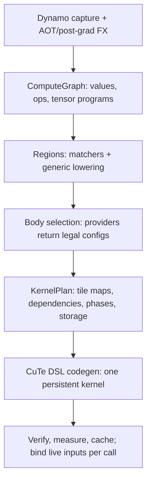

# MegaBake architecture

**Revised 2026-10-22. Sections 1–8 describe the compiler as built. Section 9 is the target design from the 2026-10-18 megakernel gap analysis, revised by the 2026-10-22 HazyResearch comparison. [roadmap.md](roadmap.md) has the measured state and the order of work. [north-star.md](north-star.md) fixes the scope.**

**Build a generic compiler that keeps fast device pipelines intact when it composes them into one kernel, and that wins where only one kernel can: tile-level dataflow, cross-op weight streaming, and work for idle SMs.**

## Principles

1. **The captured graph is the semantic reference.** Every fusion preserves guards, outputs, mutations, aliases and explicit casts.
2. **Generic by meaning, not by name.** Coverage comes from primitive families and declared ops. A named matcher (RMSNorm, RoPE) is an optimization; when it misses, generic lowering must still compile the graph.
3. **No model-keyed constants.** Tuning is keyed by device facts and problem shape, ranked by a cost model, and corrected by measurement. A constant fitted to one model or one GPU partition is a bug.
4. **A device body keeps its pipeline.** The outer compiler composes tuned GEMM and attention pipelines; it never flattens them into scalar code.
5. **Hand-written code holds only inner pipelines plus hook slots.** Norm variants, RoPE style, activations, biases and casts come from the graph and are compiled into hooks.
6. **Evidence decides.** A claim names the workload, shapes, precision, GPU, baseline and method. The baseline is the strongest equivalent one, including CUDA graphs.

## 1. Pipeline



| Stage | Module | What it does |
| --- | --- | --- |
| Capture | `frontend.py`, `fx_handler/` | `make_backend()`; pinned AOT, pre-grad and post-grad passes; capture cache; options `mode`, `fallback` |
| Declared ops | `fx_handler/hf_attention.py` | `megabake::attention` and `megabake::kv_attention` (defined in `ops/attention.py`) through transformers' `AttentionInterface`; `DecodeStep` for one-token decode over explicit KV state |
| Import | `graph.py` | `import_fx` into `ComputeGraph` (`Value`, `Op`, `Region`) |
| Lowering | `ir.py`, `lowering.py` | The tensor-program IR; tensor programs per primitive family; `UnsupportedLowering` names the gap |
| Semantic families | `ops/` | One module per family (`attention.py`, `norm.py`, `rope.py`, `gemm.py`, `elementwise.py`): the typed descriptor bodies read, its recognizer, and for declared ops the PyTorch op, eager reference and program |
| Regions | `regions.py` | Region formation: one region per op, with the `ops` candidates that end at it |
| Bodies | `bodies/` | Arch-neutral `interface.py` contracts (`BodyProvider`: candidates, `emit`, `widen`; `Generation`). `catalog.py` offers a target the generic providers plus its generation's (`cuda/sm90/__init__.py`, `cuda/sm100/__init__.py`); codegen emits every phase body through it. `cuda/generic.py`: map, reduction and contraction for any SM. `cuda/sm90/` (Hopper): `gemm.py` drives the TMA/WGMMA kernel in `cutlass_gemm.py`, a fork of the pinned CUTLASS file in `cutlass_upstream/` (`tools/vendor_cutlass.py` shows the diff); `attention.py`. `cuda/sm100/` (Blackwell, SM10x/SM12x): `gemm.py` warp-MMA correctness baseline |
| Planning | `planner.py`, `plan.py` | Body selection, tile maps, bounded plan search |
| Scheduling | `schedule.py` | Dependencies, phase schedule, event schedule, simulation |
| Storage | `memory.py` | Lifetimes, workspace reuse, per-worker scratch, plan verification |
| Codegen | `codegen.py` | Table launch (device address table) or parameter launch |
| Runtime | `runtime.py` | Cooperative launch, counting grid barrier, events |
| Orchestration | `compiler.py`, `cache.py`, `buckets.py` | Compile, admit, bind; plan cache; size buckets |

## 2. The PyTorch contract

MegaBake receives live FX after the pinned AOT and post-grad passes, before Inductor lowering. It keeps PyTorch's wrappers for lifted arguments, output structure, guards and mutations, and binds current inputs and parameters on every call. Kernel arguments are constant between calls; a call packs nothing and does not block.

- **Modes.** `mode=prefill|decode` selects policy defaults and validates the captured state contract. It cannot create a KV cache or remove outputs; the graph decides the computation.
- **Declared ops.** Stateful and complex mixers enter as declared ops with a PyTorch reference, a fake implementation and a tuned body. Attention is declared for every HF model at once through `AttentionInterface`, so it is not recovered from decomposed ATen.
- **Fallback.** `fallback=error` (default) fails before any device work. `fallback=inductor` delegates the whole invocation and labels the result `inductor_fallback`. Partitioned execution is not supported.
- **Static shapes.** `megabake.bucketed` serves variable lengths through a few compiled sizes and raises `PaddingDependence` if padding could change real outputs.

## 3. Compute graph and lowering

The graph keeps every FX operation and its source location. Import rules give known operations a **tensor program**: output and reduction domains, indexed loads, predicates, typed scalar expressions with explicit casts, and stores.

| Family | Examples |
| --- | --- |
| Contraction | GEMM, 1-D convolution |
| Pointwise and cast | arithmetic, `exp2`, `erf`, rounding, logical, min/max, clamp |
| Reduction | sums, max, norms |
| View and copy | `select`, `squeeze`, `split`→`slice`, `unsqueeze` |
| Scatter and state | `select_scatter`, `slice_scatter`, `index_put`, `copy_`, KV writes |
| Padding | constant pad |
| Opaque | kept with a lowering reason; blocks device compilation |

Not yet lowered: scans (`cumsum`), triangular solve, reductions over several axes. Inductor reaches all of core ATen with about six IR kinds; extending the families, not adding per-op rules, is the route to coverage.

## 4. Device bodies

A provider receives a region's tensor program, its `ops` descriptor (`region.semantics`), `TargetFacts` and the `SelectionPolicy` (whose `target_options` carry its generation's launch-wide choices, such as Hopper's swapAB and split-K), and returns legal `BodyConfig`s or a `ProviderRejection` with a reason. The selected config's provider also emits its device body. Each body declares its participants, scratch, barriers, completion points and resource use (`bodies/interface.py`).

| Family | Built today |
| --- | --- |
| Projection | Hopper TMA/WGMMA, 64x64x64, 8 stages. swapAB for launches with ≤ 64 rows (weight on WGMMA's M, tokens on N = 16/32/64). Bias epilogue. Deterministic split-K, off |
| GEMM epilogues (swapAB) | The elementwise chain that consumes a GEMM result runs in the register epilogue: the region's `post` expression is generated into a function evaluated per output element, reading extra operands (residual, bias, scales) by output coordinates. A **paired** GEMM computes two projections of one activation (gate/up) in a 128-row tile, 64 rows of each weight loaded by two TMA descriptors into the halves of the A stage, so the chain (SiLU·mul, GELU·mul) sees both accumulators of a row in one thread. No derived weight copies |
| Prefill attention | One warp per query row; keys in sequence |
| Decode attention | Flash decoding with the captured rounding points. A row's visible keys split into 64-key chunks across CTAs; chunks exchange their max and exponential sum once, and the last chunk merges value partials in chunk order. A row is one query head at short contexts; from 128 keys per packed head it is the query heads of a KV group (as many as fit 512 FP32 query elements; head_dim ≤ 128 only, see ROADMAP), so each cached key and value is read once for all of them. Every CTA reads the same valid length, so all run the same variant. An elementwise producer of the query or new key (RoPE) runs as a prologue: the body evaluates its program for the row into shared scratch, and appends that key to the cache |
| Norms, RoPE, activations, residuals | Generated map and reduction bodies; row-mode reductions |
| Fallback contraction | Generic indexed contraction (slow; correctness path) |
| Blackwell | `mma.sync` correctness baseline, not a performance provider |

A body processes a range of tiles while keeping its pipeline. Scratch is allocated per worker. TMA stores complete and fence before any barrier or event publishes their data.

## 5. Scheduling and launch

**Phases.** A phase is one dependency level of the plan. Persistent CTAs (one per SM) process tile ranges; a counting grid barrier (~0.7 µs at 60 CTAs) separates phases. Independent regions share a phase.

**Interval folding.** At decode sizes, small producers (norms, RoPE, elementwise) fold into their consumer's barrier interval: every CTA recomputes them instead of waiting at a barrier. A SmolLM layer costs about six barrier intervals instead of eleven. This is a megakernel-only trade: recompute is cheaper than a grid-wide wait.

**Weight streaming.** A GEMM's weights do not depend on the phases before it, so each CTA starts loading them before the GEMM's interval begins:

1. At the grid barrier that closes an interval, the CTA arrives, and warp 0 then loads the weight of its first tile in the next interval into the GEMM's pipeline stages: as many leading K tiles as the stages hold (swapAB GEMMs carry the weight as CUTLASS A). Each stage's mbarrier expects its full A + B bytes. Then the CTA waits at the barrier.
2. A tag in the GEMM's shared storage names the GEMM row. The phase that finds its own tag skips the mbarrier init and loads only the activation (B) for those K tiles. The stage completes when B lands.

Only GEMM bodies use the GEMM's shared memory, so the stages survive the phases in between. The schedule is static: rotations and tile counts fix each CTA's first tile, so a stream table holds, per streaming barrier and CTA, the GEMM row, its variant, and the CTA's rotated block. Weights qualify when no region of the launch writes them.

Streaming is **off by default** (`MEGABAKE_WEIGHT_STREAM_STAGES=0`; a positive value turns it on and caps the streamed stages). Measured against the same code compiled in without preloads, it changed decode by −0.7% to +1.5% (ROADMAP step 3). Once the SM's TMA queue is full, each load blocks the issuing warp, so a CTA waits for most of its own preload, and the loads overlap only barrier wait it had anyway. Streaming can pay only with a producer warp that the CTA's other bodies do not synchronize with. HazyResearch's megakernels do exactly this. A loader warp that never joins consumer syncs and lives across ops starts the next op's weight loads as soon as shared-memory pages free up. Their pipelining ablation cut the gap between instructions from 10.2 to 3.4 µs. Section 9 item 5 has the plan.

**Two launch forms.**

| Launch | Used when | Synchronization |
| --- | --- | --- |
| Parameter launch | Small graphs; tensors and TMA descriptors as kernel parameters | Phases or events |
| Table launch | Parameters would exceed CUDA's 32 KB limit, which is every full model | **Phases only.** Tensors come from a device address table; TMA descriptors are written per phase in the prologue; all GEMMs share one shared-memory layout |

The event schedule exists (`make_event_schedule`, `make_region_event_schedule`, `publish_event`/`wait_for_event`) but is not yet emitted for table launches. The per-CTA profile bounds its gain by barrier release (~11% of the 135M decode kernel), so it waits until after the role split and persistent pipelines (ROADMAP R1–R2). Without a producer that runs ahead, nothing uses the time a counter frees up.

**Memory.** Distinct slices first; reuse only after all consumers, including async readers, finish. Phase lifetimes prove reuse cheaply; events need reachability or explicit release.

**Synchronization rules.** A producer finishes its writes and async operations, synchronizes its CTA, then publishes with release semantics. A consumer polls with acquire loads and synchronizes its CTA before reading. TMA and other proxy accesses need their extra fences.

## 6. Verification and numerics

- Explicit source casts are rounding points and are preserved (for example FP32 accumulation → bf16 result → FP32 activation → bf16).
- Plans must match eager within a global tolerance. A global tolerance cannot separate rounding from small bugs in a deep model, so when a plan misses it, **teacher-forced verification** decides:
  1. Rerun the same kernel with every intermediate in its own workspace slice. Outputs must match the normal run bit for bit; this catches reuse and race bugs.
  2. Every region must reproduce PyTorch on the inputs the candidate produced itself, within 1% relative L2. GEMM accumulation-order noise is about 3e-4.
- `tools/diff_intermediates.py` and `tools/dump_megakernels.py` locate failures.

## 7. Latency budget

```text
savings = launches removed + traffic avoided + useful overlap
costs   = body slowdown + dispatch + synchronization + layout conversion + spills + lost parallelism
```

Against CUDA-graph replay, launches removed are worth about 0.25 µs per kernel. The savings must come from avoided traffic, overlap, and idle-SM work. If GEMMs are 90% of the baseline and become 20% slower, the workload loses even if everything else disappears. Measure the complete workload; added isolated timings are a diagnostic only.

## 8. Search and caching as built

`search_plans` enumerates body selections under a `SearchBudget` and measures candidates. **For table launches, `compile_plan` forces `max_plans=1`,** so every full model runs its greedy seed plan unmeasured. The plan cache (`make_plan_key`) keys on the selected plan, the prepared graph hash, input specs, mode, scheduler, toolchain versions and, when given, body revisions. Weights are runtime data bound by reference to the user's tensors; MegaBake owns no derived weights.

## 9. Target design

The target keeps the frontend and the persistent runtime and adds the parts below. Items 5–7 come from the 2026-10-22 HazyResearch comparison. Hazy got cross-op overlap from three things working together: fixed warp roles, paged shared memory and fine-grained counters. Megabake has measured streaming, L2 prefetch and events one at a time, and each paid little on its own. Their ordering is: roles and pages first, then counters.

1. **Mega bodies with hook slots.** A small, model-agnostic library: GEMM, attention, split-KV decode attention, row reduction, scan, grouped GEMM. Bodies are written as role functions (`load(stage)`, `compute(stage)`, `store()` plus hooks) in importable `@cute.jit` modules. The compiler calls them from generated dispatch, so `_nested_body_source` no longer rewrites their text and no longer drops helpers. Each body has typed prologue and epilogue slots, for example RMSNorm as a row-scale prologue, residual add, SiLU·mul from a paired gate/up GEMM, RoPE in the load prologue, and a q-norm folded into the softmax scale. *Built: GEMM epilogue expressions and the paired GEMM (swapAB launches), and elementwise query/key prologues in split-context decode attention (section 4).*
2. **A contract matcher.** It absorbs neighbouring ops into those slots as expressions. RoPE style, norm variant and eps, activation, bias and casts come from the graph, matched by scalar-expression normal form rather than by ATen spelling.
3. **Layout assignment over typed edge formats.** `EdgeFormat` = dtype + scale spec + data layout + scale layout. Bodies declare ranked input and output alternatives; the planner assigns them with a bytes-plus-phases cost.
4. **`transform_params`.** A bake-time stage that owns derived weights (fused QKV, paired gate/up, layout permutations), proves that each transform commutes with the computation, detects changes to the source weights, and adds a transform revision to the cache key. Permuting a producer's output rows is bit-exact; permuting a consumer's reduction columns or folding a norm weight is not and needs an opt-in numerics policy.
5. **A fixed role layout with persistent pipelines.** The table launch gets fixed roles: one producer warp that owns all TMA traffic, including weights for the next phase, and two consumer warpgroups. Generic and attention bodies become consumer-only code that synchronizes with named barriers instead of `sync_threads`. With roles fixed, `setmaxregister` can be set per role at kernel entry, so register budgets become a declared contract instead of a whole-kernel accident. GEMM ring indices and mbarrier phase bits live for the whole kernel, so the producer fills GEMM N+1's stages while GEMM N drains. *Built and off: weight streaming into shared memory from the barrier before each GEMM interval (section 5; no runtime gain without a decoupled producer warp), and L2 prefetch (measured slower).*
6. **A `ResourcePlan` and a typed phase record.** `KernelPlan` gains a layer that owns the role layout, per-role register budgets and a shared-memory page pool (fixed pages, about one GEMM stage each). It also records each CTA's per-phase page acquire and release order. The schedule is static, so the compiler derives that order; Hazy wrote it by hand (`release_lid`). Once shared memory is a pool, "all GEMMs share one shared-memory layout" stops being a structural limit. The positional phase table becomes a `PhaseRecord` dataclass that generates both the host packer and the device accessors, with a layout hash checked at load.
7. **An event scheduler, after roles.** Completion counters are added only on edges a running-ahead producer can use: GEMM→GEMM activation subsets, attention chunks, and the KV append (only the last KV block waits for the new key). Barrier ids and targets are derived from tile-region overlap, with separate RAW and WAR lists. Waits test `>=` against monotonic epoch targets; never exact equality. Weight loads need no counter. Static assignment only; dynamic work queues pay only for ~100 µs instructions in Hazy's measurements and lost to static scheduling elsewhere.

Under these sits a **device-keyed cost model**: `TargetFacts` gains L2 size, bandwidth, capabilities and MIG identity, plus a one-time calibration of barrier and event latency. Each GEMM chooses its own tile, stages, swapAB and split-K; the planner measures the top few candidates per shape and caches them by device fingerprint. Two rules come from the 2026-10-23 external Llama-1B baseline (ROADMAP). First, a phase's work items should cover the SMs: the row and K split come from the shape and the SM count, not a fixed tile. Fixed 64-row tiles leave q/k/v/o/down on ≤ 48 of 132 H100 SMs. Second, the body follows the shape class: a CUDA-core streaming matvec when M is a handful of rows, WGMMA otherwise. Third, decode attention splits only when the bytes pay for the exchange: first along dimensions that need no reduction (KV heads, value columns), then along keys, with items ≤ workers, an online softmax, and one CTA per KV head serving its query heads. Built (2026-10-27): one statistics exchange per chunk instead of two, and rows that pack a KV group's query heads at long contexts. Still fitted: the 64-key chunks, the one-wave cap and the packing thresholds (`DECODE_PACKED_*`); the score row in scratch, and with it the 8,192-key cap, remain until the online softmax. Fourth, every barrier interval carries work: an elementwise interval of a few tiles (Llama-1B's RoPE) costs a full grid barrier and folds into its producer's epilogue or its consumer's prologue instead. All four rules read only shapes and `TargetFacts`, so they hold for any model.

**Rules for growth:**

- A new body family enters only if two or more model families use it, or the work has no generic lowering.
- Providers check capabilities, never architecture strings.
- CI compiles a zoo of tiny, varied models against synthetic targets, including held-out models never used for tuning, and fails on any silent fallback to a generic body.
- Agent-written kernels may draft bodies offline behind verification, never in the compile path.
- A rule is general if it reads only shapes, dtypes, the graph and `TargetFacts`. A rule that names a model or hard-codes a size is tuning, not compiler. Take lessons from hand-written baselines in that form.
- Every trap is warp-uniform (`runtime.trap_if`), including dispatch default arms; `tools/wgmma_serialization.py` gates every change.
- Every sync site records its release and acquire side (async-store drain, `fence.proxy.async`, `red.release`, acquire poll) in codegen, not in comments. Sleep and backoff constants are explicitly typed.
- The profile is an oracle. Per-phase, per-role timing slots (compiled out by a constexpr flag) and an expected Gantt chart per model are checked alongside the reference outputs, tolerances and the inert-code control. Profile at the benchmark's operating point: decode time depends on context length, so never attribute time by subtracting runs taken at different positions.
- References are checked against the source of truth. A hand-written reference wrapper that is wrong the same way as the compiled model passes every test (a swapped `rotate_half` did this for Llama-1B), so real checkpoints are compared with Hugging Face `generate` greedy text, not only with our own wrappers.

**Example of the right structure:** vLLM's `flash_mla_mega_attn.py` combines a tuned inner pipeline, declared absorbed work, and weights permuted once at load, gated on applicability and measured profitability. MegaBake should generate that structure. The kernel itself is fixed to one model and one GPU and is not a template to copy.

## 10. Reference systems

| System | Take | Leave |
| --- | --- | --- |
| Mirage MPK | Event counters and gcd/lcm grouping, acquire polling, swapAB, epilogue tasks (`linear_with_residual`), cross-task preload, `primitives.py` helpers | Per-model builders, hard-coded task counts, the superoptimizer, the scheduler/worker split |
| HazyResearch Megakernels (`mk-v2*` branches) | Persistent loader/consumer/storer roles, shared-memory pages handed from op to op, per-head/per-chunk/last-KV-block counters, mk-v2's typed 256-byte instruction struct and host-derived RAW/WAR barriers, constexpr-gated timing slots | The generic opcode interpreter (deleted from ThunderKittens main in TK 2.0), hand-written `release_lid` tables and literal barrier counts, per-token host counter resets, exact-equality waits, the DAG scheduler with ready times commented out |
| ThunderKittens 2.0 | Elected single-thread issuers, packed phase-bit fields, mbarrier waits with memory clobbers (fixed 2026-09) | Sixteen thin consumer warps (2026 kernels use fewer, fatter consumers); LCF/LCSF callback templates |
| CUDA graphs + PDL Llama-1B baseline ([megakernels-vs-cuda-graphs](https://github.com/msaroufim/megakernels-vs-cuda-graphs) `llama/kernels/`) | One CTA per two output rows for batch-1 projections; weights loaded before the dependency wait (PDL); weights repacked once for wide loads; norm, RoPE and the KV write in the QKV epilogue; decode attention that never splits short contexts; the whole decode loop in one graph | Hand-written per-layer fusion modes, Llama-1B constants, Triton attention recompiled per position |
| Inferact TPU megakernels | One continuous weight stream across op and layer boundaries (bank ring) | Per-architecture decode functions, TPU layouts |
| vLLM | Declared custom ops for stateful mixers; the structure of its fused DeepSeek kernels | eps and hidden-size gates in fusion patterns |
| Inductor | Primitive-family coverage, decompositions, device-keyed autotune tables | — |
| CUTLASS CuTe, DeepGEMM, FBGEMM | GEMM mechanics; targeted references for a measured gap | Host APIs; they add launches |
